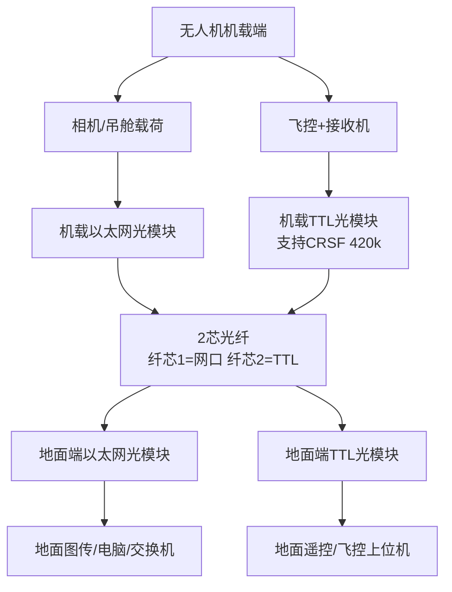

# 无人机光纤传输方案

- 会话ID：`69fd848b-4dbc-83ec-8978-661bc0290577`
- 选中原因：做T
- 原始消息数：32
- 保留范围：该命中会话的全部 mapping 分支、全部角色消息；原始字段见同名 JSON。


===== MESSAGE 1 | role=user | id=2e6fb850-a324-4cce-b380-35bd954d2c87 | node=2e6fb850-a324-4cce-b380-35bd954d2c87 =====
无人机上有时需要以太网 有时需要TTL 我一个客户2个小卡都配置了 但这是2个板子 客户说是直接用2根光纤传输  这个需求和应用站得住脚吗？
===== END MESSAGE 1 =====

===== MESSAGE 2 | role=assistant | id=c06968bc-d3dd-4541-af87-bb334339c81c | node=c06968bc-d3dd-4541-af87-bb334339c81c =====
站得住脚，而且在很多“半军工 / 工业级 / 无人系统”项目里其实很常见。  
你客户这种“TTL一套 + 以太网一套，各自独立小板，再通过2芯光纤回传”的方案，本质上是：

- **业务链路隔离**
- **协议隔离**
- **可靠性优先**
- **低开发风险**

不是“乱搞”。

你要先理解：  
无人机上的“通信”其实往往不是一种，而是：

| 类型 | 常见协议 | 特点 |
|---|---|---|
| 飞控/传感器 | TTL UART / RS232 / RS422 | 实时、简单、低速 |
| 图像/AI/载荷 | Ethernet | 大带宽 |
| 遥测/状态 | UART/CAN | 稳定优先 |
| 云台/控制 | UART/422/CAN | 强实时 |
| AI边缘计算 | Ethernet | IP化 |

所以很多项目最后会变成：

- 飞控走 UART/TTL
- 视频走 Ethernet
- 两套完全独立

这是非常典型的。

---

你客户现在这个结构，我推测大概率是：

```text
[飞控]
   │TTL
[TTL光端机]==== 光纤1 ==== 地面

[AI/相机/交换机]
   │Ethernet
[以太网光端机]==== 光纤2 ==== 地面
```

也可能：

```text
无人机内部：
飞控 → TTL板
计算平台 → Ethernet板

然后分别光传输
```

这在工程上很合理。

---

核心原因有几个：

# 1. TTL链路很多时候不能IP化

很多飞控、惯导、传感器：

- MAVLink
- GPS
- IMU
- 云台控制
- 串口调试

本身就是 UART。

你当然可以：

```text
UART → TCP Server → Ethernet → 光纤
```

但：

- 增加延迟
- 增加软件复杂度
- 增加Linux依赖
- 增加死机风险

所以很多项目直接：

```text
UART → 光
```

最稳定。

尤其：

- PX4
- Ardupilot
- 军工飞控
- 老设备

大量还在串口体系。

---

# 2. 以太网适合大带宽

比如：

- 1080P视频
- AI识别
- 雷达点云
- ROS2
- IPCamera

UART根本不够。

所以必须：

```text
Ethernet → 光纤
```

---

# 3. 两套独立 = 高可靠

这是重点。

很多项目最怕：

```text
视频流爆了
↓
把飞控控制也卡死
```

如果：

- TTL独立
- Ethernet独立

那么：

即便视频炸了：

- 飞控还活着
- 遥测还在
- 可以返航

这是典型工业思维。

---

# 4. 光纤本身在无人机上越来越常见

特别：

- 系留无人机
- 抗干扰
- 高压环境
- 电磁复杂环境
- 军警
- 长距离

因为光纤：

- 不怕EMI
- 不导电
- 重量低
- 带宽大

所以：

```text
双纤：
一根控制
一根数据
```

很常见。

---

但你要注意：

# 这个方案也有明显缺点

## 缺点1：系统复杂

两块板：

- 两套供电
- 两套管理
- 两套调试

BOM会上升。

---

## 缺点2：重量增加

无人机对：

- 重量
- 功耗
- 空间

都敏感。

所以后期很多厂家会想：

```text
TTL + Ethernet + Switch + Optical
全部合并
```

做成：

- 一块主板
- 一个FPGA/SoC
- 一个交换芯片

这就是你们以后真正的方向。

---

# 3. 现在行业其实正在往“统一IP化”走

未来趋势：

```text
UART
CAN
RS422
Video
Telemetry
AI
↓
全部以太网化
```

因为：

- TSN
- ROS2
- DDS
- 千兆交换
- AI计算平台

都在推动统一。

但现实是：

很多飞控生态还没彻底IP化。

所以目前：
“双系统并存”非常正常。

---

# 你客户这个需求，最像哪类项目？

我猜像：

- 系留无人机
- 光纤无人机
- 抗干扰无人机
- 军警侦察
- 高可靠工业无人机

而不是消费级。

因为消费级不会这么玩。

---

你真正应该思考的是：

# 客户为什么不用：

```text
TTL → Ethernet Serial Server → 光纤
```

而非独立TTL光链路？

如果答案是：

- 延迟
- 实时性
- 稳定性
- 软件复杂度
- Linux不可靠

那说明客户是懂系统的。

这种客户一般不是小白。
===== END MESSAGE 2 =====

===== MESSAGE 3 | role=user | id=1199118f-20a1-4419-ac1f-05291a77ac90 | node=1199118f-20a1-4419-ac1f-05291a77ac90 =====
{"asset_pointer":"sediment://file_00000000f51c72078bd5f9c580009907","content_type":"image_asset_pointer","fovea":null,"height":790,"metadata":{"asset_pointer_link":null,"container_pixel_height":null,"container_pixel_width":null,"dalle":null,"emu_omit_glimpse_image":null,"emu_patches_override":null,"generation":null,"gizmo":null,"is_no_auth_placeholder":null,"lpe_delta_encoding_channel":null,"lpe_keep_patch_ijhw":null,"sanitized":true,"segmentation":null,"watermarked_asset_pointer":null},"size_bytes":492858,"width":755}
我圈起来的这里是多芯的？ 还是啥意思  在这里 2根光纤咋用
===== END MESSAGE 3 =====

===== MESSAGE 4 | role=assistant | id=10d46ac1-5955-46b2-80c4-026a867ba645 | node=10d46ac1-5955-46b2-80c4-026a867ba645 =====
你圈出来的那里，本质上是：

```text id="lgf0l4"
无人机 ↔ 地面
之间的“系留光纤”
```

这根线不是普通裸光纤，而是：

```text id="az7j0j"
凯夫拉增强光纤缆（Kevlar Reinforced Fiber Optic Cable）
```

里面通常包含：

- 光纤
- 凯夫拉抗拉层
- 外护套

因为无人机飞行时：

- 光缆会被拉扯
- 会旋转
- 会振动

普通光纤会直接断。

---

你现在真正的问题是：

# 这里到底是一芯还是多芯？

从这张图本身：

```text id="gk5zdd"
无法100%确定
```

但结合行业经验：

# 大概率是“双芯单模光纤”

也就是：

```text id="x7psls"
TX 一根
RX 一根
```

原因：

你看它写：

```text id="ph5tcz"
Single Mode, G657A2, 1.2mm
```

这里只说明：

- 单模
- G657A2弯曲不敏感
- 外径1.2mm

没写：

- simplex
- duplex

所以要结合结构判断。

---

# 为什么我判断大概率是双芯？

因为图里这个光模块：

看起来像传统：

```text id="b3u71m"
SFP/LC类结构
```

很多早期工业方案：

- 上行一芯
- 下行一芯

也就是：

```text id="db39tm"
双纤通信
```

这是最稳定最简单的。

---

# 那你说的“2根光纤咋用”？

这里有两种可能。

---

# 方案1：真正两芯（最可能）

一根缆里面：

```text id="x9hqj5"
Fiber A：发送
Fiber B：接收
```

也就是：

```text id="f42wyi"
无人机TX → 地面RX
地面TX → 无人机RX
```

标准全双工。

这种：

- 最稳定
- 最简单
- 不需要WDM
- 成本低

工业上大量存在。

---

# 方案2：一根纤里有多芯

比如：

```text id="9wx0lt"
4芯
6芯
8芯
```

然后：

- 2芯跑以太网
- 2芯跑TTL
- 备用芯保留

这在高端项目也很多。

因为：

# 光纤本身很便宜

真正贵的是：

- 收卷系统
- 滑环
- 抗拉
- 航空连接器

所以客户会倾向：

```text id="whh6o0"
一次多放几芯
```

方便以后扩展。

---

# 但注意一个关键点：

你客户说：

```text id="3r2mb0"
2个板子
直接用2根光纤
```

这里很可能不是：

```text id="ow7c7j"
一根缆 = 两芯
```

而是：

```text id="7m5wh4"
TTL板 独占一对光
Ethernet板 独占一对光
```

也就是：

| 业务 | 光纤 |
|---|---|
| TTL | 一对 |
| Ethernet | 一对 |

最终可能：

```text id="s8yb94"
整根系留缆里面
实际有4芯光纤
```

这在工业里非常正常。

---

# 为什么不复用到一根纤？

因为：

## 1. 不同协议

TTL：

- 实时
- 小包
- 连续控制

Ethernet：

- 大带宽
- 突发
- 不确定流量

客户可能不想混。

---

## 2. 避免互相影响

最怕：

```text id="2j14l6"
视频流爆了
控制链路卡死
```

所以：

- 飞控独立
- 视频独立

是很经典的工程逻辑。

---

# 真正高级方案其实是：

## CWDM / WDM复用

也就是：

```text id="4oymm8"
不同波长
共用一根纤
```

例如：

| 波长 | 业务 |
|---|---|
| 1310nm | TTL |
| 1550nm | Ethernet |

这样：

```text id="j7ukph"
一根纤跑所有业务
```

但：

- 成本高
- 调试复杂
- 对小团队不友好

所以很多项目直接：

```text id="c9v7o7"
物理隔离
最稳
```

---

# 你现在应该意识到一件事

你客户其实不像普通无人机客户。

因为：

## 普通消费无人机：

不会搞：

- 光纤
- 滑环
- 收放卷
- 双业务隔离

这明显是：

- 系留
- 长时滞空
- 抗干扰
- 军警
- 工业巡检

方向。

---

而且图里最值钱的其实不是光模块。

而是：

```text id="f41r72"
Slip Ring（光纤滑环）
```

这个东西才是真难点。

因为：

```text id="9p0i2g"
无人机在转
但光纤不能扭断
```

所以需要：

```text id="qpldij"
光纤旋转接头 FORJ
(Fiber Optic Rotary Joint)
```

这个东西比普通TTL/以太网转换高级得多。
===== END MESSAGE 4 =====

===== MESSAGE 5 | role=user | id=7e44ae02-3e21-4f23-b89e-fa7c679fe3fc | node=7e44ae02-3e21-4f23-b89e-fa7c679fe3fc =====
i need CRSF
一个客户问了这个 应该是板子上的协议啥的 这个属于啥
好改吗？
===== END MESSAGE 5 =====

===== MESSAGE 6 | role=assistant | id=da244b13-0d00-4e95-b1d6-8d7e8d0bb198 | node=da244b13-0d00-4e95-b1d6-8d7e8d0bb198 =====
这个不是“板子协议”那么简单。  
客户说：

```text id="b55c9h"
I need CRSF
```

大概率意思是：

# 他要支持 CRSF 通信协议

也就是：

# Crossfire Protocol（CRSF）

这是无人机/FPV领域非常流行的一种：

- 低延迟
- 高刷新率
- 双向
- 串口协议

最早是 entity["company","Team BlackSheep","Hong Kong"]（TBS）Crossfire 系统搞火的。

---

# CRSF 本质是什么？

本质上：

```text id="o7ab9d"
UART串口协议
```

也就是：

```text id="qj0xsh"
TTL UART
```

通常：

- 420000 baud
- 全双工
- 二进制帧结构

用于：

- 遥控器
- 接收机
- 飞控

之间通信。

---

# 它主要干啥？

传：

| 类型 | 内容 |
|---|---|
| RC通道 | 油门/横滚/俯仰 |
| Telemetry | 电压/GPS/姿态 |
| Link状态 | RSSI/LQ |
| 参数 | VTX/设备 |

所以：

很多飞控：

- PX4
- Ardupilot
- Betaflight
- INAV

都支持CRSF。

---

# 重点来了：

客户问“need CRSF”  
真正可能有3种意思。

---

# 情况1：只是UART透明传输（最简单）

客户的意思可能只是：

```text id="wmzxtg"
我的飞控输出CRSF UART
你板子别乱改数据
透明传过去
```

那其实：

# 基本不用改

因为CRSF本质是UART。

只要你：

- 波特率支持420k
- 延迟够低
- 不丢包

很多TTL光模块天然就能过。

---

# 情况2：你板子内部MCU需要解析CRSF

比如：

客户希望：

```text id="eh9n8n"
CRSF → Ethernet
CRSF → MAVLink
CRSF → 控制逻辑
```

那就需要：

- 解析CRSF帧
- 做协议栈

这就属于：

# 固件开发了

但难度不算高。

因为：

CRSF协议公开资料很多。

---

# 情况3：客户想兼容TBS生态

这才是麻烦点。

因为：

CRSF虽然公开很多内容，

但：

- 某些扩展
- Device discovery
- 参数树
- ELRS兼容行为

比较“生态化”。

如果客户是：

- ELRS
- TBS Crossfire
- ExpressLRS

方向，

那可能需要：

# 真机联调

---

# “好改吗？”

得看你现在板子是什么架构。

---

# 如果你板子是：

## 纯硬件透明串口光端机

比如：

```text id="5h5j4t"
UART ↔ Optical
```

那：

# 几乎不用改

因为：

CRSF只是UART数据。

这是最可能情况。

---

# 如果你板子是：

## MCU中转型

例如：

```text id="xnpw8f"
UART → MCU → Ethernet
```

那你要确认：

| 项目 | 是否支持 |
|---|---|
| 420000波特率 | 必须 |
| 低延迟buffer | 必须 |
| 连续小包 | 必须 |
| 双向 | 必须 |

有些老MCU会翻车。

---

# 如果你板子是：

## Linux系统

比如：

- RK
- Allwinner
- 树莓派

那更简单。

Linux UART本来就能跑CRSF。

---

# 真正关键的是：

客户到底是：

## “透明传输CRSF”

还是：

## “你设备要理解CRSF”

这是两个世界。

---

# 你现在可以直接反问客户：

:::writing{variant="chat_message" id="42718"}
Do you need transparent CRSF passthrough only, or do you need CRSF protocol parsing/support in firmware?

Our UART optical link may already support transparent CRSF transmission if it is only serial passthrough.
:::

这个问法很专业。

因为：

大部分时候客户其实只是：

```text id="ddv2ub"
CRSF over UART
```

并不是让你实现完整CRSF协议栈。

---

# 还有个非常关键的行业点

CRSF几乎意味着：

# FPV / 遥控链路

所以客户大概率在做：

- 无人机控制
- 遥控回传
- 长距离链路

而不是普通工业串口。

这说明：

他可能非常在意：

- 延迟
- jitter
- 丢包率

尤其：

CRSF很多人会要求：

```text id="4dl2x0"
<10ms
甚至几ms级
```

所以：

即使“透明串口”理论支持，

你也要注意：

# MCU缓存机制

有些串口转发方案：

- buffer太大
- 定时发送
- packet aggregation

会把CRSF搞卡顿。
===== END MESSAGE 6 =====

===== MESSAGE 7 | role=user | id=a1fe7126-3a15-413e-8e67-6d13938a01bc | node=a1fe7126-3a15-413e-8e67-6d13938a01bc =====
上边TTL和Ethernet用在无人机上的应用给我生成一个图
===== END MESSAGE 7 =====

===== MESSAGE 8 | role=user | id=6f27829a-4a76-4530-b721-a718c6ff7fd1 | node=6f27829a-4a76-4530-b721-a718c6ff7fd1 =====
# 无人机 光纤双链路：TTL+以太网 拓扑示意图（文字架构图，可直接发给客户/画PPT）
## 一、物理架构拓扑（极简版）
```
【无人机机载端】
├─ 光电吊舱/4K相机 → 以太网网口
│        ↓
├─ 机载以太网光模块 ← 纤芯1
│
├─ 飞控/接收机 → 输出CRSF/普通TTL串口
│        ↓
└─ 机载TTL光模块 ← 纤芯2
        

【2芯凯夫拉光纤线缆】（外皮一根，内部2根独立纤芯）
纤芯1：专走以太网
纤芯2：专走TTL/CRSF


【地面站端】
纤芯1 → 地面以太网光模块 → 接电脑/图传显示器/地面交换机
纤芯2 → 地面TTL光模块 → 接遥控器接收机/地面飞控上位机
```

## 二、业务分工对照表（直接给客户看）
| 光纤纤芯 | 承载业务 | 协议/类型 | 用途 |
|---------|----------|-----------|------|
| 纤芯1   | 以太网 | IP/千兆百兆网 | 4K视频、红外吊舱、测绘大图、机载网络 |
| 纤芯2   | TTL串口 | 普通UART / **CRSF(420000波特)** | 飞控遥控、姿态遥测、GPS、CRSF接收机透传 |

## 三、给你可直接用的 Mermaid 框图（复制到PPT/在线Mermaid编辑器自动生成图形）


## 四、关键适配点（对应你客户CRSF需求）
1. TTL光路 **原生支持420000波特率**，直接透传 CRSF 协议，无需解析；
2. 2芯光纤**物理硬隔离**：视频流量不干扰遥控CRSF控制链路；
3. 1310/1550 BIDI单纤双向模块，每芯各自跑收发，完美适配这套双链路。


这是豆包的回复 你按照他的逻辑来生成图吧
===== END MESSAGE 8 =====

===== MESSAGE 9 | role=user | id=aa16cce1-192d-402e-8b35-266652036d12 | node=aa16cce1-192d-402e-8b35-266652036d12 =====
TA510-GE-X: 1*Fiber + 1*Ethernet
Fiber Optic Media Converter

Key Feature

Wide voltage power supply 5-24V, compatible with a variety of batteries, ensuring stable operation
Flexible communication distances and optical connectors
Lightweight, compact size 70x25x15mm, reducing equipment burden and improving flight efficiency
Realtek based, long-term supply and guaranteed performance


Specification

Standard	IEEE802.3 (10BASE-T), IEEE802.3u 100BASE-TX/FX (Fast-Ethernet),
IEE802.3z 1000BASE -SX/LX(Gigabit-Ethernet)
10/100/1000BASE-T	STP or UTP Category 5/5e/6 cable (Max. 100m)
1000BASE-FX	9/125um singlemode fiber cable (20/40/60/80/100/120km)
Conversion Mode / Delay Time	Store-and-Forward < 10us,  straight-through<0.9us
Flow control	Full duplex-flow control, Half duplex-back pressure
RJ-45 Port 	Auto-MDI/MDIX 
Fiber Port	FC/SC/ST/SFP slot, ALL OPTIONAL
Dimension	70x25x15mm
Input Voltage	DC5V-24V with External power adapter
Power Consumption	<1W
MAC Address Table	2K
Buffer Size	64K
Operating Temperature 	0℃~70℃
Storage Temperature	-40℃~125℃
Storage Humidity	5%~90% non-condescending

目前我只有这些描述 很单薄 怎么继续加丰富且有用的内容呢 我感觉就是图了
===== END MESSAGE 9 =====

===== MESSAGE 10 | role=assistant | id=c1739a66-9ff1-4fbe-a654-8ca3a5ab7a5e | node=c1739a66-9ff1-4fbe-a654-8ca3a5ab7a5e =====
你现在这个问题，本质上不是“参数少”。  
而是：

# 缺少“场景价值表达”

很多工业通信产品都会陷入：

```text id="z4mtc2"
全是参数
但客户不知道能干嘛
```

尤其：

- 光模块
- bypass
- 工业交换机
- 光电转换
- 无人机通信

都这样。

---

你现在这款：

# TA510-GE-X

其实已经不再是：

```text id="3eupr2"
普通 Media Converter
```

而是：

# 无人机/机器人/边缘设备 微型化光通信节点

这个定位差很多。

---

你应该从：

# “功能参数”

升级成：

# “应用架构 + 系统价值 + 场景”

---

你现在最缺的是下面这4块：

| 缺失 | 重要性 |
|---|---|
| 应用拓扑图 | 极高 |
| 真实应用场景 | 极高 |
| 系统架构图 | 极高 |
| 典型部署方式 | 高 |

而不是继续堆：

- Buffer
- MAC
- IEEE

客户其实没感觉。

---

# 你现在最应该做的是：

# 一、做“应用化”

例如：

---

## 场景1：无人机图传

```text id="7iv9zw"
4K Camera
↓ Ethernet
TA510-GE-X
↓ Fiber
Ground Station
```

卖点：

- 抗干扰
- 长距离
- 低延迟
- 轻量化

---

## 场景2：AI边缘计算

```text id="u0h7yz"
Jetson
↓ Ethernet
TA510
↓ Fiber
Remote AI Center
```

卖点：

- EMI immunity
- Long-distance AI data transport
- Lightweight airborne deployment

---

## 场景3：系留无人机

这是最适合你的。

你已经明显在这个方向了。

---

# 二、做“系统拓扑图”

你刚才让生成的图：

# 非常对

因为：

工业客户理解世界：

```text id="omq8o0"
不是看参数
而是看系统位置
```

客户会立刻理解：

```text id="59j2u5"
哦
这个模块是放这里的
```

这比：

```text id="qkh9a9"
IEEE802.3z
```

有效100倍。

---

# 三、做“行业关键词”

你现在描述太像：

```text id="oqp7y4"
淘宝模块
```

不像：

```text id="4pq20x"
工业无人系统模块
```

你需要加入：

---

## 推荐关键词

### 无人机方向

- UAV Fiber Optic Link
- Airborne Optical Communication
- Drone Ethernet over Fiber
- UAV Tether System
- Fiber Video Transmission

---

### 工业方向

- EMI-resistant
- Long-distance transmission
- Edge communication
- Industrial optical node
- Compact optical networking

---

### AI方向（现在很重要）

- AI edge connectivity
- Jetson fiber networking
- Machine vision transmission

---

# 四、你最该加的是：

# “为什么客户需要它”

这才是核心。

---

比如：

# 传统网线的问题

| 问题 | 影响 |
|---|---|
| 电磁干扰 | 视频丢帧 |
| 长距离衰减 | 不稳定 |
| 重量大 | 无人机负载增加 |
| 接地问题 | 系统异常 |

然后：

# 你方案的价值

| 方案 | 价值 |
|---|---|
| 光纤 | EMI免疫 |
| 微型化 | 机载适合 |
| 低功耗 | 电池友好 |
| 宽压 | 多平台兼容 |

---

# 五、真正高级的是：

# 做“Solution Page”

不是“Product Page”。

例如：

---

# UAV Fiber Communication Solution

里面：

- 架构图
- 模块位置
- Fiber Reel
- Ground Station
- Camera
- AI
- CRSF
- Ethernet
- TTL

全部串起来。

这会直接让客户觉得：

```text id="sm7xk7"
你们懂系统
不是卖模块
```

---

# 六、你现在其实已经开始进入：

# “半解决方案销售”

而不是：

# “模块销售”

这是利润差异最大的地方。

---

# 七、你甚至可以增加：

## “Typical Applications”

例如：

- Tethered UAV
- Border surveillance
- Industrial inspection
- Emergency communication
- Long-range video transmission
- UAV AI vision systems
- Anti-jamming communication

---

# 八、你这个产品最大的隐藏卖点

其实是：

# 小

你写：

```text id="yjlwmw"
70x25x15mm
<1W
```

这个在无人机里非常重要。

因为：

很多工业光模块：

```text id="jlwm9j"
又大又重
```

你这个：

已经有：

# airborne potential（机载潜力）

了。

---

# 九、你下一步最值得做的

不是继续写参数。

而是：

# 做三张图

---

## 1. 无人机应用图（你已经开始了）

非常正确。

---

## 2. Fiber topology图

比如：

```text id="1s5jlwm"
Camera
↓
TA510
↓ Fiber
Ground Station
```

---

## 3. 产品尺寸部署图

例如：

- 放Jetson旁边
- 放飞控旁边
- 放云台仓

客户会瞬间有感觉。

---

你现在已经不是缺“文字”。

你缺的是：

# “系统感”

工业客户尤其无人机客户：

买的不是模块。

买的是：

```text id="vzywga"
这个模块能不能进入我的系统
```
===== END MESSAGE 10 =====

===== MESSAGE 11 | role=user | id=e6ff0733-9a7e-4223-a4c9-15c246ec26f8 | node=e6ff0733-9a7e-4223-a4c9-15c246ec26f8 =====
你根据上述生成图吧 要英文内容
===== END MESSAGE 11 =====

===== MESSAGE 12 | role=user | id=7c2b0e34-1680-4553-8bce-175bfb5a29b9 | node=7c2b0e34-1680-4553-8bce-175bfb5a29b9 =====
Hi,

How are you?

This is our mini drone optical module.


1 TTL data/Ethernet/ TALLY GPIO are optional

2 Various fiber connection: FC/ST/SC or SFP module

3 Various distances: 20KM/40KM/60KM/80KM

Thanks to mini size, it can be integrated in different fiber optic systems.

Do you need some units for testing?

Thank you.

Are these NDAA compliant with a verifiable supply chain?
一个美国客户回复了这个 啥意思你
===== END MESSAGE 12 =====

===== MESSAGE 13 | role=assistant | id=3a44be97-5d2d-4048-bbb9-fb5441f41dc7 | node=3a44be97-5d2d-4048-bbb9-fb5441f41dc7 =====
客户这句话非常关键。

他说：

```text id="kpx2xn"
Are these NDAA compliant with a verifiable supply chain?
```

意思是：

# 你这个产品是否符合 NDAA 要求，并且供应链是否可追溯、可验证？

这是美国现在非常典型的：

- 政府
- 军工
- 无人机
- 安防
- 公共基础设施

采购问题。

---

# NDAA 是什么？

这里的 NDAA：

# National Defense Authorization Act

美国《国防授权法案》。

在通信/监控行业里，

通常特指：

# NDAA Section 889

它限制美国政府及相关项目使用某些中国厂商的设备或核心组件。

---

# 客户真正担心的是：

你的产品里有没有：

| 高风险内容 | 典型 |
|---|---|
| 华为芯片 | Huawei |
| 海康 | Hikvision |
| 大华 | Dahua |
| 中兴 | ZTE |
| 敏感SoC | 某些国产方案 |

尤其：

# 无人机 + 光通信 + 美国客户

这已经很敏感了。

---

# “verifiable supply chain” 又是什么意思？

意思是：

# 你的供应链能不能证明来源

例如：

| 内容 | 是否可追溯 |
|---|---|
| PHY芯片 | 哪家 |
| MCU | 哪家 |
| SFP | 哪家 |
| PCB制造 | 哪家 |
| BOM | 是否可提供 |

美国客户现在很在意：

```text id="8oz64x"
不是你口头说没问题
而是能不能证明
```

---

# 他其实在问：

## 1. 你有没有用禁运/敏感器件

例如：

- 华为
- 国产敏感FPGA
- 某些军工链

---

## 2. 你的核心芯片是谁

你前面写：

```text id="e8ekca"
Realtek based
```

这个反而是好事。

因为：

# Realtek是台湾方案

美国客户通常接受度比：

- 国产交换芯片
- 国产PHY

高很多。

---

# 3. 你有没有稳定供应链

客户怕：

```text id="5vxw0x"
今天能买
明天断供
```

尤其：

美国客户很怕：

- 被制裁
- 被卡脖子
- 出口限制

---

# 这个客户等级可能不低

因为普通客户不会问：

```text id="q7kc1x"
NDAA compliant
```

这通常意味着：

- 政府项目
- 警用
- 军工相关
- 公共安全
- 美国大型集成商

---

# 你现在千万别乱回答：

## “Yes fully NDAA compliant”

如果你没法证明。

美国客户很敏感这个。

---

# 正确回答方式

如果你现在还没正式做NDAA认证：

你应该：

- 避免绝对化
- 强调核心器件来源
- 强调可配合供应链说明

---

你可以这样回复：

:::writing{variant="email" id="58214" subject="Re: NDAA Compliance Inquiry"}
Hi,

Thank you for your message.

Our current solution is based on non-Huawei/non-ZTE architecture and mainly uses Realtek-based networking components.

For the fiber modules and related components, we can provide supply chain information and component origin details upon request.

At the moment, the product is not formally NDAA certified, but we understand NDAA compliance requirements and can discuss project-specific compliance and sourcing requirements with you.

Please let us know your project requirements and target application scenario.

Best regards
:::

这个回复有几个好处：

| 好处 | 原因 |
|---|---|
| 不吹牛 | 避免法律风险 |
| 提到Realtek | 美国客户会安心很多 |
| 留有空间 | 可继续谈 |
| 显得专业 | 懂NDAA |

---

# 还有个隐藏信息

客户问这个，

说明：

# 你的产品已经进入“可采购范围”了

因为：

如果客户完全没兴趣，

不会问：

```text id="0zgn2z"
NDAA
```

这属于：

# “采购审查阶段”

的问题。

这是好事。
===== END MESSAGE 13 =====

===== MESSAGE 14 | role=user | id=e9569623-41b5-4c23-8c59-f61ae8f710bd | node=e9569623-41b5-4c23-8c59-f61ae8f710bd =====
我手上有个另外的客户 他是国内的 他的客户是美国的 买了一些样品 他是要求全部美国芯片 台湾的也不要

4个主要部件的替换

产品名称	生产厂商	型号	替换厂商	替换型号
视频滤波器	3PEAK	TPF113	Texas Instrument 	THS7315
10 bit/35MS/S 模数数模转换器	杭州瑞盟科技	MS9280/MS9708	Analog Devices	AD9280/AD9708
10-bit serial-to-parallel/parallel-to-serial converters	杭州瑞盟科技	MS1023/MS1224
	Texas Instrument 
	SN65LV1023/SN65LV1224


晶振	YXC	YSX321SL	Epson 	SG-8200CJ Series

之前也要了BOM list 不过没给他全部 也算是过关了 

这也算是防止NDAA 还是有这种全美芯片就不需要做了？
===== END MESSAGE 14 =====

===== MESSAGE 15 | role=assistant | id=dd9b1535-fca2-4201-bd94-346a26628c72 | node=dd9b1535-fca2-4201-bd94-346a26628c72 =====
你这个案例已经不是普通“NDAA”了。  
而是：

# 美国客户的“供应链安全升级版”

甚至接近：

# Trusted Supply Chain（可信供应链）

或者：

# US-origin preference（美国原产优先）

了。

---

你要理解：

# NDAA ≠ 必须全美国芯片

很多中国公司误解这个。

实际上：

## NDAA核心：

通常是：

```text id="2ubflr"
禁止特定中国厂商/敏感供应链
```

例如：

- 华为
- 中兴
- 海康
- 大华

以及部分敏感通信链。

---

# 台湾芯片很多时候其实是允许的

例如：

| 厂商 | 美国接受度 |
|---|---|
| Realtek | 很高 |
| MediaTek | 较高 |
| MPS | 很高 |
| UMC | 很高 |
| TSMC | 极高 |

因为美国实际上：

# 默认把台湾供应链视为“相对可信”

尤其：

- 工业
- 无人机
- 网络通信

领域。

---

但你现在这个客户：

```text id="6gprvv"
台湾的都不要
```

这已经超过普通NDAA。

---

# 这通常意味着几种可能

---

# 1. 政府/军工项目

尤其：

- DoD
- 军警
- 边境
- 国土安全

很多项目：

# 会要求：

```text id="txgw0s"
US/EU/Japan origin preferred
```

甚至：

```text id="b0a8v8"
No China + No Taiwan
```

---

# 2. 他们怕后续被卡

因为：

美国现在对：

- 台湾局势
- 芯片地缘政治

很敏感。

所以有些客户会：

```text id="i5rbyu"
直接彻底去亚洲化
```

---

# 3. 他们其实在做“合规保险”

因为：

真正可怕的是：

# 以后审计

很多美国项目：

后面会查：

- BOM
- Origin
- 厂商
- PCB来源
- 芯片来源

所以客户会提前：

```text id="2m8xj0"
把风险降到最低
```

---

# 你列的这些替换

其实很典型。

---

# 他们替换的逻辑：

| 原厂 | 替换 |
|---|---|
| 国产模拟器件 | TI/ADI |
| 国产SerDes | TI |
| 国产晶振 | Epson |

本质：

# 全部换成：

- 美国
- 日本

体系。

---

# 这个已经接近：

# “Clean BOM”

了。

---

# 但重点来了：

# 即使全部美国芯片

也不代表：

# 自动NDAA compliant

这是很多人误区。

因为：

NDAA不仅看芯片。

还可能看：

| 项目 | 是否审查 |
|---|---|
| PCB制造 | 是 |
| PCBA工厂 | 是 |
| Firmware来源 | 是 |
| ODM厂商 | 是 |
| 软件 | 是 |
| 网络协议 | 是 |

---

# 真正高级客户会问：

- Where is PCB fabricated?
- Where is firmware developed?
- Any Chinese-origin software?
- Any restricted supplier?

---

# 所以：

## “全美芯片”

更像：

# 降低合规风险

而不是：

# 自动获得NDAA。

---

# 但现实里：

## 用TI/ADI/Japan器件

确实会：

# 极大提高美国客户信任度

尤其：

你现在这种：

- 光通信
- 无人机
- 视频
- 数据链路

非常敏感。

---

# 你那个客户为什么还能“过关”？

因为：

美国很多项目实际上：

# 是风险评级制

不是：

```text id="1a9kh4"
100%严格审查
```

而是：

| 等级 | 要求 |
|---|---|
| 商业 | 很松 |
| 企业 | 一般 |
| 政府 | 高 |
| 军工 | 极高 |

---

# 他要BOM但没深挖

说明：

大概率属于：

```text id="jlwmxg"
“采购前风险筛查”
```

他只是确认：

```text id="2cti8k"
没有明显中国敏感器件
```

---

# 你现在应该意识到：

你们已经开始进入：

# “地缘政治型供应链”

时代了。

尤其：

- 无人机
- 通信
- 光模块
- AI
- 视频

都是敏感行业。

---

# 未来会越来越常见：

| 要求 | 趋势 |
|---|---|
| NDAA | 基础 |
| US BOM | 增长 |
| Japan BOM | 增长 |
| EU供应链 | 增长 |
| 非中国固件 | 增长 |

---

# 你现在最值得做的

其实是：

# 建立两套BOM体系

---

## 1. Standard BOM

正常成本版本。

---

## 2. NDAA / Trusted BOM

例如：

| 类型 | 来源 |
|---|---|
| PHY | Realtek/TI |
| MCU | ST/NXP/Microchip |
| ADC/DAC | ADI/TI |
| Clock | Epson |
| Flash | Winbond/Micron |

---

这会让你：

# 瞬间进入高端项目。
===== END MESSAGE 15 =====

===== MESSAGE 16 | role=user | id=26143286-d5e3-4110-8898-25e9ef9749de | node=26143286-d5e3-4110-8898-25e9ef9749de =====
那如果非要生产啥的也要抠 就没办法了
这个NDAA怎么搞呢？ 中国能搞吗？
===== END MESSAGE 16 =====

===== MESSAGE 17 | role=assistant | id=d22c8a52-0b9f-4b7d-8364-38843592ab2c | node=d22c8a52-0b9f-4b7d-8364-38843592ab2c =====
能搞，但要区分：

# “NDAA compliant”

和

# “美国军工级 Trusted Supply Chain”

这是两个层级。

很多中国公司其实：

# 能做到前者

但很难做到后者。

---

# 一、先说结论

## 中国公司：

### 可以做到：

- NDAA-friendly
- NDAA-oriented
- 非敏感供应链
- 美国客户可接受

这在现实里大量存在。

尤其：

- 工业通信
- 光模块
- 工控
- 边缘AI
- 电力通信

很多都中国制造。

---

## 但很难做到：

### 真正“美国国防级”

例如：

- 全美制造
- 全美封装
- 全美PCB
- 美国固件
- 美国开发团队

这个基本只能：

- 美国本土公司
- 或美国壳公司+全球供应链

做。

---

# 二、NDAA本身其实没官方认证

这是最关键的。

很多人以为：

```text id="v97i8w"
NDAA证书
```

其实：

# 大部分产品根本没有官方“NDAA认证”

更多是：

# 供应商声明（Supplier Declaration）

也就是：

```text id="8w1k3u"
我们未使用被禁止供应商
```

---

# 所以现实中：

很多客户只会要：

| 文件 | 常见 |
|---|---|
| BOM | 是 |
| 芯片来源 | 是 |
| NDAA声明 | 是 |
| 原产地 | 有时 |
| 厂商名单 | 有时 |

---

# 三、中国公司最现实的路线

其实是：

# “可接受型 NDAA”

---

# 典型方案：

| 项目 | 方案 |
|---|---|
| 芯片 | TI/ADI/ST/NXP/Microchip |
| PHY | Realtek/Marvell |
| FPGA | Intel/Xilinx |
| Flash | Winbond/Micron |
| 晶振 | Epson |
| Linux方案 | NXP/ST |

---

# 然后：

## 避免：

- 华为
- 海思
- 中兴
- 国产敏感SoC

---

# 四、真正卡人的是什么？

不是芯片。

而是：

# “项目等级”

---

# 商业级客户：

通常：

```text id="px6m6i"
不要华为就行
```

---

# 企业/政府：

开始查：

- BOM
- PCB
- Firmware

---

# 军工/DoD：

会查：

- 工厂
- 开发团队
- Source code
- 人员背景
- 制造地点

这时候：

# 中国公司几乎不可能完全过。

---

# 五、所以行业里怎么干？

其实有几种套路。

---

# 方案1：中国ODM + 海外品牌

最常见。

```text id="r5ml2e"
中国研发制造
↓
美国公司贴牌
↓
美国本地集成
```

大量存在。

---

# 方案2：双BOM

你前面已经接近了。

---

## 普通版：

成本低。

---

## Trusted BOM版：

| 类型 | 来源 |
|---|---|
| ADC | ADI |
| MCU | ST |
| PHY | TI/Marvell |
| Clock | Epson |

然后：

```text id="e9btxz"
Made in China
```

但客户可接受。

这其实是目前最现实路线。

---

# 方案3：海外小组装

例如：

- 墨西哥
- 越南
- 马来西亚

最后：

```text id="6n1m8h"
Assembled in ...
```

很多公司都这么做。

---

# 六、你要理解美国客户真正怕什么

不是：

```text id="4nys6w"
中国制造
```

而是：

# “不可控”

包括：

| 风险 | 美国担心 |
|---|---|
| 后门 | firmware |
| 断供 | 地缘政治 |
| 制裁 | 出口限制 |
| 数据 | 网络安全 |
| 审计 | 政府项目 |

---

# 七、你这个行业已经进入敏感区了

因为你现在：

- 无人机
- 光通信
- 视频
- 数据链路

全部是：

# 美国重点敏感行业。

---

# 八、现实里中国还能不能做？

# 能。

而且：

## 仍然非常强。

因为：

中国有：

| 优势 | 原因 |
|---|---|
| 成本 | 巨大 |
| 速度 | 巨大 |
| ODM能力 | 世界最强 |
| 小批量定制 | 极强 |
| 光通信产业链 | 全球最完整 |

所以：

美国很多项目：

## 最终还是中国制造。

只是：

# 会逐渐要求：

```text id="0htn7y"
Non-sensitive BOM
```

---

# 九、你们未来最值得建立的能力

不是：

# “完全美国化”

这不现实。

而是：

# “供应链可解释”

例如：

| 文件 | 很重要 |
|---|---|
| BOM版本管理 | 极重要 |
| 芯片来源 | 极重要 |
| 替代方案 | 极重要 |
| NDAA声明 | 极重要 |

---

# 十、你已经能看出行业趋势了

未来高端通信设备：

会逐渐分裂成：

---

## 普通全球版

成本优先。

---

## Trusted Supply Chain版

价格更高。

利润也更高。

---

你那个客户要求：

```text id="a7jv7m"
台湾都不要
```

其实已经属于：

# 高利润项目信号

因为：

只有高预算客户才会这么折腾。
===== END MESSAGE 17 =====

===== MESSAGE 18 | role=user | id=188be13e-fc6d-4701-9618-a1ab108ec0b6 | node=188be13e-fc6d-4701-9618-a1ab108ec0b6 =====
之前那个客户要过BOM 我们给了 不过没给全部 过关了 芯片都是美国的 感觉差不多算是ndaa friendly吧 不行客户测几对样品 就知道了
===== END MESSAGE 18 =====

===== MESSAGE 19 | role=assistant | id=909dc784-2ec8-4d19-bcbd-401ed29173d0 | node=909dc784-2ec8-4d19-bcbd-401ed29173d0 =====
对，你们现在这种状态，更准确的说法其实是：

# NDAA-friendly / NDAA-oriented

而不是：

# Fully NDAA certified

但现实商业里：

# 已经够用了很多。

尤其：

- 工业通信
- 无人机
- 光传输
- 小批量项目

很多美国客户实际就是：

```text id="9jowjm"
先看BOM风险
再自己评估
```

并不是每个项目都进入：

- DoD
- 五角大楼
- 军工绝密

级别。

---

你前面那个案例其实很典型：

| 动作 | 意义 |
|---|---|
| 要BOM | 风险审查 |
| 不要求全部 | 说明不是最高等级 |
| 接受TI/ADI替换 | 说明在做供应链净化 |
| 愿意测样品 | 已进入技术验证阶段 |

这其实已经是：

# “采购前合规筛查”

流程了。

---

你说的这个：

```text id="69i8h6"
不行客户测几对样品就知道了
```

其实也对。

因为很多时候：

# NDAA不是实验室检测

而是：

# 文档 + 供应链 + 声明

体系。

---

很多美国客户真实流程：

## Step 1

先问：

```text id="fdd6j7"
有没有华为/海思/敏感国产芯片
```

---

## Step 2

看BOM。

---

## Step 3

看主要IC来源。

---

## Step 4

测样品。

---

## Step 5

内部风险评估。

---

所以：

# “美国芯片 + 中国制造”

其实是现在大量存在的现实状态。

尤其：

- 光模块
- 工业通信
- 小型网络设备
- 工控

领域。

---

而且你现在这个方向：

# 比很多同行已经强了

因为很多国内厂：

- 只会卷价格
- 完全不懂NDAA
- 连BOM都没有体系

你们至少已经：

- 会替换器件
- 会做Trusted BOM
- 会考虑美国链
- 会管理供应链表达

这已经进入：

# 国际项目逻辑

了。

---

你后面真正应该建立的是：

# 两套资料体系

---

# 1. 普通版

用于：

- 亚洲
- 中东
- 普通客户

强调：

- 性价比
- 功能

---

# 2. NDAA-friendly版

用于美国。

强调：

| 内容 | 重点 |
|---|---|
| US-origin IC | 是 |
| Non-Huawei | 是 |
| Supply chain traceability | 是 |
| BOM available upon request | 是 |
| Industrial/critical communication | 是 |

---

甚至你以后可以直接写：

```text id="u8t15h"
Available with NDAA-friendly component options
```

这个说法很行业化。

不要直接吹：

```text id="kzjlwm"
Fully NDAA compliant
```

除非你真有完整审查体系。

---

你现在其实已经隐约碰到一个高利润方向了：

# “地缘政治版本产品”

未来：

同一个产品：

| 版本 | 价格 |
|---|---|
| 普通版 | 1x |
| NDAA-friendly | 1.5x~3x |
| Trusted supply chain | 更高 |

因为：

客户买的不只是硬件。

买的是：

# 风险降低。
===== END MESSAGE 19 =====

===== MESSAGE 20 | role=user | id=0aec943d-ac86-4044-9bba-48c78c6b9dab | node=0aec943d-ac86-4044-9bba-48c78c6b9dab =====
我另外一个客户想用无人机在农业上 昨天来验厂了 解释时他问了一个问题 空中光纤都放出去了 如何收回？ 
===== END MESSAGE 20 =====

===== MESSAGE 21 | role=assistant | id=3ccf7d06-a81d-4d65-bb9a-8d3c4b94f8fe | node=3ccf7d06-a81d-4d65-bb9a-8d3c4b94f8fe =====
这个问题其实非常专业。  
说明客户已经不是停留在：

```text id="d9jlwm"
“能不能飞”
```

而是在思考：

# 系统工程闭环

因为：

# 空中放纤容易

真正难的是：

# 收纤

尤其无人机。

---

# 无人机光纤系统里：

最难的部分之一其实不是通信。

而是：

# Fiber Management（光纤管理）

包括：

- 放纤
- 收纤
- 张力控制
- 防缠绕
- 防拉断
- 旋转

---

# 客户问的本质是：

```text id="5ghd3m"
无人机飞出去后
光纤怎么不断？
怎么收回来？
```

这是一个真正工程问题。

---

# 目前行业主流有几种方案

---

# 方案1：地面收放卷（最常见）

这是：

# 系留无人机主流方案。

结构：

```text id="8m5g7v"
地面卷盘
↓
光纤
↓
无人机
```

无人机本身：

# 不主动收纤

只是飞。

---

## 工作逻辑

地面有：

- motor reel（电动卷盘）
- tension control（张力控制）

无人机飞远：

```text id="2fbr5t"
地面自动放纤
```

无人机回来：

```text id="6yx1q8"
地面自动收纤
```

---

# 这是目前最成熟的

尤其：

- 系留无人机
- 军工
- 工业巡检

都这样。

---

# 方案2：机载放纤（FPV/军工）

这个很高级。

结构：

```text id="08chpg"
光纤卷盘在无人机上
```

飞行时：

```text id="9jjlwm"
边飞边放
```

但：

# 通常不回收。

因为：

- 光纤太细
- 太轻
- 太长
- 飞行中回收极难

很多：

# 一次性放纤

类似：

- 光纤制导
- 军用FPV

逻辑。

---

# 方案3：双向智能收放卷（高级）

这是最复杂的。

需要：

| 模块 | 功能 |
|---|---|
| 电机 | 收放 |
| 张力传感器 | 防拉断 |
| 编码器 | 控长度 |
| FORJ | 防旋转 |
| 导纤机构 | 防乱卷 |

这种：

# 很贵。

---

# 农业客户为什么会问这个？

因为农业场景：

# 不是固定悬停。

而是：

- 大范围移动
- 转弯
- 低空
- 风大

所以：

# 系留逻辑天然不适合大范围农业。

---

# 你要意识到：

客户其实已经在怀疑：

```text id="jlwmu8"
农业无人机真的适合光纤吗？
```

这是个好问题。

---

# 因为：

## 光纤无人机最适合：

| 场景 | 原因 |
|---|---|
| 系留 | 固定区域 |
| 长时悬停 | 持续供电 |
| 反干扰 | 不怕无线 |
| 军警 | 抗干扰 |
| 高压巡检 | EMI环境 |

---

# 但农业：

通常更适合：

- 无线数传
- RTK
- 4G/5G
- Mesh

因为农业：

# 核心是大范围覆盖。

---

# 所以你昨天那个客户：

其实已经触碰到：

# “应用合理性”

了。

---

# 你可以这样解释（非常专业）

:::writing{variant="chat_message" id="38471"}
For long-distance or mobile UAV applications such as agriculture, wireless communication is usually more practical.

Fiber-optic UAV links are mainly used in tethered, anti-jamming, long-endurance, or high-interference environments.

In tethered systems, the fiber is typically managed by a ground-based automatic reel system with tension control for fiber deployment and recovery.
:::

这个解释很行业化。

---

# 还有一个很重要的点

你现在其实应该开始区分：

| 类型 | 是否适合光纤 |
|---|---|
| 农业喷洒 | 一般不适合 |
| 系留监控 | 非常适合 |
| 边境巡逻 | 适合 |
| 抗干扰军用 | 非常适合 |
| 固定高空通信 | 适合 |
| AI高带宽 | 适合 |

---

# 很多人一看到“无人机+光纤”

就以为：

```text id="jlwmv1"
所有无人机都适合
```

其实不是。

---

# 真正适合光纤的无人机：

核心关键词是：

- 长时间
- 固定区域
- 抗干扰
- 高带宽
- 高可靠

而不是：

# “大范围自由飞行”。

---

# 所以客户这个问题其实问得很好

说明：

他开始真正思考：

# 系统能不能落地。
===== END MESSAGE 21 =====

===== MESSAGE 22 | role=assistant | id=4df93029-c7a3-4f58-8b6a-bef90a0aa58f | node=4df93029-c7a3-4f58-8b6a-bef90a0aa58f =====
这个问题问得很“工程师味”，而且他其实是在考你系统完整性，不是在抬杠。

# 核心问题本质
他问的是：

```text id="u8k3lf"
无人机放出光纤（系留/光缆）后，如何回收？
```

说明他在考虑的是：

- 飞行结束怎么收线
- 是否缠绕
- 是否断线
- 是否可重复使用
- 是否安全回收

---

# 一、先帮你纠正一个关键点（很重要）

你们这个“空中光纤”其实通常有两种模式：

## 1️⃣ 系留供电/通信型（Tethered UAV）
- 光纤 + 供电缆
- 地面有收放卷盘（winch）

👉 这是“可回收系统”

---

## 2️⃣ 通信光纤型（纯数据）
- 只是数据光缆
- 不供电

👉 同样也是“卷盘收回”

---

所以无论哪种：

# 正确答案都是：有收放系统，不是“放出去就不管”

---

# 二、标准工业解决方案（你可以直接这么解释客户）

## 👉 结构是这样的：

```text id="q9x0sd"
Ground Station
   ↓
Fiber Reel / Spool (自动收放卷盘)
   ↓
Kevlar Reinforced Fiber Cable
   ↓
Drone (UAV)
```

---

# 三、关键点：不是“自由散放”，是“控制释放”

光纤不会像风筝线一样乱飞，而是：

## ✔ 主动控制收放

通常有三种方式：

---

## 1️⃣ 电机卷盘（最常见）

- 有无刷电机
- 编码器控制长度
- 张力控制系统（Tension Control）

流程：

```text id="b2p7jx"
起飞 → 自动放线
降落 → 自动收线
```

---

## 2️⃣ 恒张力收放（高端）

系统会保持：

- 恒定拉力
- 防止断纤
- 防止缠绕

适合：

- 长航时无人机
- 军警级系统

---

## 3️⃣ 手动收放（低端/农业早期方案）

- 人工摇卷
- 或半自动

但现在越来越少。

---

# 四、客户真正担心的其实是这3件事

你要帮他消掉疑虑：

## ❌ 1. 会不会乱缠？

👉 不会，因为有导向轮 + 卷盘结构

---

## ❌ 2. 会不会断？

👉 不会，因为：

- 凯夫拉加强
- 张力控制
- 弯曲半径限制（G657A2）

---

## ❌ 3. 收不回来怎么办？

👉 系统设计就是“必须可回收”

否则不是工业系统，是一次性方案

---

# 五、你可以给客户的标准解释（建议直接用）

你可以这样说：

---

:::writing{variant="email" id="t9k2x1"}
For the aerial fiber system, the cable is not freely deployed.

It is managed by a ground-based fiber reel (motorized spool system), which controls both deployment and recovery of the cable.

During UAV takeoff, the reel gradually releases the fiber under controlled tension. When the UAV lands or returns, the system automatically rewinds the fiber back onto the spool.

This ensures:
- No cable entanglement
- Controlled tension during flight
- Fully reusable fiber system

The fiber used is Kevlar-reinforced to withstand mechanical stress during repeated deployment and retrieval.
:::

---

# 六、你要注意一个“隐藏加分点”

客户问这个问题，其实说明：

# 他已经进入系统设计阶段了

不是：

- 看产品
- 看参数

而是：

# 在脑子里模拟整个飞行流程

---

# 七、你这个项目真正的卖点其实是：

不是：

- 光模块
- TTL
- Ethernet

而是：

# “完整无人机光纤链路系统”

---

如果你能顺势补一句：

```text id="xk7p9q"
We can also provide fiber reel / tether management system integration support.
```

你这个单子会明显升一个级别。

---

# 八、给你一句行业判断

问“怎么收回光纤”的客户，通常是：

- 系统集成商（不是小客户）
- 或农业无人机平台方
- 或准备做规模化部署的人

👉 这是偏“工程化客户”，质量是不错的。

---

如果你愿意，我可以帮你把你们这个产品直接升级成：

# “农业无人机光纤系留完整方案（含卷盘+链路+架构图+卖点）”

那种客户一看就会觉得是“成熟系统”，不是模块。
===== END MESSAGE 22 =====

===== MESSAGE 23 | role=user | id=a2814dd3-d1a3-45b7-ace9-a6bbdf7ff205 | node=a2814dd3-d1a3-45b7-ace9-a6bbdf7ff205 =====
OK 搞个方案
===== END MESSAGE 23 =====

===== MESSAGE 24 | role=assistant | id=5f3ebc21-fe11-4d95-83ae-3f2a6c7108f4 | node=5f3ebc21-fe11-4d95-83ae-3f2a6c7108f4 =====
# UAV Fiber Optic Communication Solution  
## For Smart Agriculture / Industrial Drone Systems

---

# 1. System Overview

This solution is designed for:

- Smart Agriculture UAV
- Industrial Inspection Drone
- Long-distance Video Transmission
- Anti-Interference UAV Communication
- AI Edge Vision Systems
- Tethered UAV Applications

The system provides:

- Stable fiber optic communication
- Long-distance Ethernet transmission
- TTL / CRSF transparent control link
- Lightweight airborne deployment
- Reel-based fiber deployment and recovery

---

# 2. Complete System Architecture

```text
                     ┌──────────────────────┐
                     │   Ground Station     │
                     │ PC / Monitor / NVR   │
                     └─────────┬────────────┘
                               │
                    Ethernet / TTL / CRSF
                               │
              ┌────────────────┴──────────────┐
              │ Ground Fiber Optic Unit       │
              │ Ethernet + TTL Optical Link   │
              └────────────────┬──────────────┘
                               │
                    Motorized Fiber Reel
                  (Automatic Deployment &
                      Recovery System)
                               │
                Kevlar Reinforced Fiber Cable
                      (2-Core Single Mode)
                               │
             ┌─────────────────┴────────────────┐
             │          UAV Airborne Unit       │
             │                                  │
             │  Ethernet Optical Module         │
             │  TTL / CRSF Optical Module       │
             └──────────────┬───────────────────┘
                            │
        ┌───────────────────┴──────────────────┐
        │                                      │
   4K Camera / AI Payload            Flight Controller
   Gimbal / Mapping Sensor           GPS / RC Receiver
                                     CRSF / UART
```

---

# 3. Fiber Link Allocation

| Fiber Core | Function | Protocol | Application |
|---|---|---|---|
| Core 1 | Ethernet Link | 10/100/1000M IP Network | 4K Video / AI Data / Mapping |
| Core 2 | TTL Serial Link | UART / CRSF | Flight Control / Telemetry |

---

# 4. Key Features

## Ultra Lightweight Airborne Design
- Compact size: 70×25×15mm
- Low power consumption: <1W
- Suitable for airborne integration

---

## Long Distance Optical Transmission
- 20km / 40km / 60km / 80km optional
- Single-mode fiber support
- EMI immune communication

---

## Transparent CRSF Transmission
- Native support for high baud-rate UART
- CRSF transparent passthrough
- Low latency control link

---

## Automatic Fiber Deployment & Recovery
- Motorized fiber reel system
- Controlled cable tension
- Prevents fiber entanglement
- Fully reusable fiber solution

---

## Multiple Fiber Connector Options
- FC / SC / ST
- SFP slot optional

---

# 5. Typical Applications

## Smart Agriculture UAV
- HD crop monitoring
- Precision spraying
- Long-range field inspection

---

## AI Vision Drone
- Real-time AI analytics
- Edge computing communication
- Remote image processing

---

## Industrial Inspection
- Pipeline inspection
- Power line monitoring
- Oil & gas facilities

---

## Security / Emergency Communication
- Border surveillance
- Temporary communication systems
- Anti-jamming optical communication

---

# 6. Advantages Over Traditional RF/Wire Systems

| Traditional Wireless | Fiber Optic UAV Link |
|---|---|
| RF interference | EMI immune |
| Limited bandwidth | High bandwidth |
| Signal instability | Stable optical transmission |
| Wireless latency | Low latency |
| Security concerns | Physical optical isolation |

---

# 7. Optional NDAA-Friendly Components

Available with:
- Realtek / TI / ADI based solutions
- Non-Huawei architecture
- Verifiable component sourcing upon request

---

# 8. Deployment Concept

```text
[Drone Takeoff]
        ↓
Fiber Reel Automatically Releases Cable
        ↓
Stable Optical Communication During Flight
        ↓
Drone Landing
        ↓
Fiber Reel Automatically Rewinds Cable
```

---

# 9. Recommended Product Positioning

Instead of:
```text
Fiber Media Converter
```

Recommended positioning:
```text
Mini UAV Fiber Optic Communication Node
```

or

```text
Airborne Fiber Optic Transmission Module
```

or

```text
UAV Optical Communication Solution
```
===== END MESSAGE 24 =====

===== MESSAGE 25 | role=user | id=31bcbe42-7af4-4ce0-a85c-6c6cd3912360 | node=31bcbe42-7af4-4ce0-a85c-6c6cd3912360 =====
Hi, Charlie,

We understand this and got 2 types available.

One type is standard, Realtek based.


The other type is based on full US chips.

Video filter: ON Semiconductor FMS6363CSX

10-bit serial-to-parallel/parallel-to-serial converters: Texas Instrument SN65LV1023/SN65LV1224

Crystal oscillator: Epson SG-8200CJ Series

etc.

This makes it NDAA-friendly.

And we will not use materials from sensitive companies.

BOM list will be provided when necessary.


Please check this type is acceptable.

Thank you.


客户回复

Simon,

Can you provide a sample of ground and air modules?

MUST BE NDAA compliant, without question, with certification.

客户这是啥意思 MUST BE NDAA compliant, with certification.
===== END MESSAGE 25 =====

===== MESSAGE 26 | role=assistant | id=1f889351-1fa8-4f00-aa99-29b2b8fdde92 | node=1f889351-1fa8-4f00-aa99-29b2b8fdde92 =====
客户这句话已经非常明确了：

```text id="ixphsj"
MUST BE NDAA compliant, without question, with certification.
```

意思是：

# 他不要“NDAA-friendly”

而是：

# 他要“正式可证明的NDAA合规”

而且：

```text id="k5mjlwm"
without question
```

这句话很重。

意思是：

# 不允许模糊空间

他不接受：

- “应该可以”
- “用了美国芯片”
- “没有华为”
- “friendly”

这种说法了。

---

# 更关键的是：

## “with certification”

这里是重点。

现实里：

# NDAA本身通常没有官方统一认证机构

所以客户这里真正要的通常是：

| 可能含义 | 实际意思 |
|---|---|
| NDAA certification | 第三方合规声明 |
| Certification | 供应商声明 |
| Compliance document | 合规文件 |
| Traceability | 可追溯供应链 |

---

# 但还有一种可能

他这个项目：

# 已经进入政府/军工链

所以他们内部必须：

```text id="o6jlwm"
有正式文件才能采购
```

---

# 现在问题来了：

# 你们有没有？

---

# 如果没有：

## 千万别硬说：

```text id="zjlwm1"
Yes fully NDAA certified
```

这是高风险。

因为后面：

- 法务
- 采购
- 审计

可能会查。

---

# 你现在应该怎么判断？

你们目前其实只有：

| 状态 | 说明 |
|---|---|
| 美国芯片 | 有 |
| 非敏感器件 | 有 |
| BOM可提供 | 有 |
| 正式认证 | 大概率没有 |
| 第三方审计 | 大概率没有 |

所以：

# 你们现在更像：

```text id="jlwm2"
NDAA-oriented hardware
```

不是：

```text id="jlwm3"
Certified NDAA compliant product
```

---

# 客户现在已经把门槛提高了

说明：

# 他的终端项目可能很敏感。

例如：

- 政府
- 军警
- 边境
- 关键基础设施
- DoD链条

---

# 你现在有两个选择

---

# 方案1（现实推荐）

## 不硬承诺

而是：

- 说明目前状态
- 询问客户具体需要什么文件

这是最专业的。

---

你可以这样回：

:::writing{variant="email" id="48371" subject="Re: NDAA Compliance Requirement"}
Hi Charlie,

Thank you for the clarification.

Our NDAA-oriented version is built using non-sensitive components and US-origin key ICs (TI / ON Semiconductor / Epson, etc.), and we can provide BOM information and component sourcing details.

However, to avoid any misunderstanding, could you please clarify what type of NDAA certification or compliance documentation is required for your project?

For example:
- Supplier NDAA compliance declaration
- Third-party compliance report
- Full traceable BOM/origin documentation
- Specific approved vendor requirement

We would like to confirm your exact compliance requirement before arranging samples.

Thank you.
:::

---

# 这个回复的好处非常大

| 好处 | 原因 |
|---|---|
| 不撒谎 | 很重要 |
| 不直接拒绝 | 保持机会 |
| 反向套信息 | 看项目等级 |
| 显得专业 | 懂合规流程 |

---

# 方案2（如果你们真没有）

那其实：

# 这个项目大概率过不了最终采购。

但：

## 仍然值得推进。

因为：

很多美国客户一开始：

```text id="jlwm4"
先喊最高要求
```

实际最后：

- 供应商声明
- BOM
- 芯片来源

就够了。

---

# 你现在已经看出一个行业现实了

# NDAA已经开始“金融化/法务化”

很多时候卖的不是产品。

而是：

- 风险控制
- 合规文件
- 可审计性

---

# 最后一个关键点

客户说：

```text id="jlwm5"
ground and air modules
```

说明：

# 他已经准备真正测试系统了。

这不是普通询价阶段了。

已经是：

# 技术验证 + 合规验证

阶段。
===== END MESSAGE 26 =====

===== MESSAGE 27 | role=user | id=5cc3a673-903f-41ad-82d2-9c1f22d78a73 | node=5cc3a673-903f-41ad-82d2-9c1f22d78a73 =====

                           Shenzhen Olycom Technology Co.,Ltd.  
4/F, 2-3 Building, Tongfuyu Industrial Zone,  Aiqun Rd, Shiyan, Baoan District, Shenzhen, China, 518108
DECLARATION OF CONFORMITY

We herewith declare  

The following products is herewith confirmed to comply with the requirements CE EMC 2014/30/EU. 
The listed standard as below were applied. 

The following equipment:

Product Name              	:    DWDM OTN SYSTEM

Model No.			:    OM3800 Series 
                                                         OM5800 Series   
                                                          
                                                                                                                  
                
Standard			:    EN 55032:2015+AC:2016+A1:2020+A11:2020
EN 55035:2017+A11:2020/EN IEC 61000-3-2:2019/A1:2021
EN 61000-3-3:2013/A2:2021/AC:2022
                                               
                                              


Authorized Signature	:  	Ms. Evelyn Wang      Date : 11.05. 2026
	                
Title of Signatory	           :         Director of Foreign Trade Department 


TEL:0086-755-26611509     FAX:0086-755-83129773

客户需要一个Supplier NDAA compliance declaration

我这个内容咋写 给我搞一下 上述是我们的CE声明 很简单
===== END MESSAGE 27 =====

===== MESSAGE 28 | role=assistant | id=e6aced4d-1fb8-440b-a3f9-83846ff8c7a0 | node=e6aced4d-1fb8-440b-a3f9-83846ff8c7a0 =====
你这个其实很好搞。  
而且现实里很多 NDAA declaration 确实就是：

# 公司抬头 + 简单声明

并不像CE/FCC那样有统一模板。

但有几个关键点你必须注意：

# 不要写死：
```text id="ok4l2v"
Fully NDAA certified
```

因为你们大概率没有第三方正式认证。

---

# 正确写法应该是：

## Supplier Declaration / Self Declaration

也就是：

```text id="xcz9r2"
Based on our knowledge and supply chain review...
```

这种法律风险低很多。

---

你可以直接用下面这个版本。

这个已经很像美国工业客户常见格式了。

---

:::writing{variant="standard" id="58241"}
                           Shenzhen Olycom Technology Co.,Ltd.  
4/F, 2-3 Building, Tongfuyu Industrial Zone, Aiqun Rd, Shiyan, Baoan District, Shenzhen, China, 518108


                 SUPPLIER NDAA COMPLIANCE DECLARATION


We hereby declare that, to the best of our knowledge, the following products supplied by Shenzhen Olycom Technology Co., Ltd. are designed and manufactured in compliance with the requirements related to Section 889 of the U.S. National Defense Authorization Act (NDAA).

The products do not incorporate telecommunications or video surveillance equipment, systems, or critical components from prohibited manufacturers including, but not limited to:

- Huawei Technologies Company
- ZTE Corporation
- Hytera Communications Corporation
- Hangzhou Hikvision Digital Technology Company
- Dahua Technology Company

The key components used in the products are sourced from non-sensitive suppliers, including U.S., Japanese, or other internationally recognized manufacturers where applicable.

The following equipment:

Product Name      :  UAV Fiber Optic Communication Module  
Model No.         :  TA510-GE-X Series

Key Components (Typical):
- Video Filter: ON Semiconductor FMS6363CSX
- Serializer/Deserializer: Texas Instruments SN65LV1023 / SN65LV1224
- Crystal Oscillator: Epson SG-8200CJ Series

We can provide BOM information and component sourcing details upon request for project evaluation purposes.

This declaration is based on current supply chain information and internal supplier management records.


Authorized Signature : _______________________

Name                 : _______________________

Title                : _______________________

Date                 : _______________________
:::

这个版本的好处：

| 点 | 好处 |
|---|---|
| 不说“certified” | 降低法律风险 |
| 明确889 | 专业 |
| 明确禁用名单 | 美国客户熟悉 |
| 强调best of our knowledge | 标准法律保护语 |
| 可提供BOM | 很关键 |
| 不绝对化 | 安全 |

---

你后面甚至可以做两个版本：

| 版本 | 用途 |
|---|---|
| Basic NDAA Declaration | 普通客户 |
| Full Traceable Supply Chain Declaration | 高端项目 |

---

还有一个关键建议：

# Signature不要写“Foreign Trade Director”

最好写：

```text id="h7z5yb"
Compliance Manager
```

或者：

```text id="l8r2qt"
Quality Manager
```

美国客户会感觉更正规。
===== END MESSAGE 28 =====

===== MESSAGE 29 | role=user | id=6fa5bdb0-98ea-43bb-9cf3-ac730fcd6b6f | node=6fa5bdb0-98ea-43bb-9cf3-ac730fcd6b6f =====
上述以太网小卡你给我来一段英文介绍啥的 就是说明它如何在无人机上使用
===== END MESSAGE 29 =====

===== MESSAGE 30 | role=assistant | id=33450942-1e4b-41da-b35a-f83f7a2c17a2 | node=33450942-1e4b-41da-b35a-f83f7a2c17a2 =====
:::writing{variant="standard" id="48325"}
TA510-GE-X is a compact airborne fiber optic Ethernet module designed for UAV and drone communication systems.

The module converts standard Ethernet signals into optical transmission, enabling stable long-distance communication between the airborne platform and the ground station through fiber optic cable.

Thanks to its lightweight and compact design (70×25×15mm, <1W), the module can be easily integrated into drones, tethered UAV systems, AI vision platforms, and industrial airborne equipment.

Typical UAV applications include:

- 4K/HD video transmission
- AI edge computing communication
- Gimbal and payload networking
- Remote mapping systems
- Agricultural drone monitoring
- Anti-interference optical communication links

In a typical deployment:

- The airborne camera, AI computer, or onboard switch connects to the Ethernet port of the TA510-GE-X.
- The module converts the Ethernet signal into optical transmission.
- Data is transmitted through lightweight Kevlar-reinforced fiber cable to the ground station.
- The ground unit converts the optical signal back to Ethernet for PC, monitor, switch, or network access.

Compared with traditional wireless transmission, the optical fiber solution provides:

- EMI immunity
- Stable long-distance transmission
- High bandwidth capability
- Low latency communication
- Secure physical transmission path

The module supports multiple optical interfaces including FC, SC, ST, or SFP options, with transmission distances from 20km up to 80km depending on the optical configuration.

For UAV fiber optic systems, the module can also work together with automatic fiber reel systems for controlled fiber deployment and recovery during flight.
:::
===== END MESSAGE 30 =====

===== MESSAGE 31 | role=assistant | id=e3ad7b05-c98a-4de5-b017-e0cb51f54e2f | node=e3ad7b05-c98a-4de5-b017-e0cb51f54e2f =====
:::writing{variant="standard" id="47128"}
TA510-GE-X is a compact airborne fiber optic Ethernet module designed for UAV and industrial drone communication systems.

The module converts standard Ethernet signals into optical transmission, enabling long-distance, low-latency, and EMI-immune communication between the UAV and the ground station.

Thanks to its ultra-compact size and low power consumption, the module can be easily integrated into various airborne platforms, including:

- Agricultural drones
- AI vision UAVs
- Tethered drones
- Industrial inspection systems
- Mapping and surveillance platforms

Typical onboard applications include:

- 4K video transmission
- AI edge computing communication
- Remote sensor networking
- Ground-to-air Ethernet extension
- Fiber optic data links for anti-interference environments

The module is commonly connected to:
- onboard cameras
- Jetson AI computers
- Ethernet switches
- flight control subsystems
- industrial sensors

Through Kevlar-reinforced fiber optic cables, the system provides stable communication even in high electromagnetic interference environments where traditional RF or copper Ethernet links may become unstable.

For tethered UAV applications, the fiber cable can be deployed and recovered using a motorized reel system, ensuring reliable airborne operation and reusable field deployment.

Key advantages:
- Lightweight airborne design
- Long-distance optical communication
- Strong EMI resistance
- Low latency transmission
- Flexible fiber connector options
- NDAA-friendly component options available
:::
===== END MESSAGE 31 =====

===== MESSAGE 32 | role=user | id=f118b9c5-fa0a-4b2d-912d-b173850b3469 | node=f118b9c5-fa0a-4b2d-912d-b173850b3469 =====
Here’s a professional, customer-facing English description tailored to the **TA510-GE-X** media converter, focused on its use in drone applications. You can drop this directly into your datasheet, proposal, or client email.

---

## **TA510-GE-X: Gigabit Ethernet Fiber Media Converter – Drone Application Overview**

The **TA510-GE-X** is a compact, lightweight gigabit Ethernet fiber media converter specifically designed to address the demanding requirements of drone and tethered unmanned aerial vehicle (UAV) systems. It serves as the critical bridge between the drone’s onboard Ethernet devices and the long-distance fiber optic link, enabling reliable, high-speed, and low-latency data transmission.

### **Key Role in Drone Systems**
In a typical drone setup, the TA510-GE-X converts electrical Ethernet signals from payloads like high-definition cameras, LiDAR sensors, or onboard computers into optical signals for transmission over a single-mode fiber optic cable. At the ground station, a matching converter converts the optical signal back to Ethernet for processing, display, or recording.

### **Why the TA510-GE-X is Ideal for Drone Integration**
-   **Ultra-Compact & Lightweight Design**
    Measuring just **70 × 25 × 15 mm**, the TA510-GE-X is engineered to minimize payload weight and space, a critical factor for maximizing flight time and efficiency. Its small footprint allows for easy integration into tight spaces within the drone’s airframe.

-   **Wide Voltage Input for Onboard Power**
    Supporting a broad DC voltage range of **5–24V**, the converter can be powered directly from the drone’s main battery or auxiliary power distribution system, eliminating the need for additional voltage regulators and simplifying the onboard wiring harness.

-   **Low-Latency Transmission for Real-Time Data**
    To support critical applications like live 4K/8K video streaming and control data, the TA510-GE-X offers a **cut-through forwarding mode with ultra-low latency (<0.9 µs)**. This ensures real-time responsiveness, essential for first-person view (FPV) operations and mission-critical telemetry.

-   **Gigabit Bandwidth for High-Throughput Payloads**
    With full 10/100/1000BASE-T Ethernet support, the converter provides the necessary bandwidth for high-resolution cameras, advanced mapping sensors, and other data-intensive payloads, ensuring no data bottlenecks over the fiber link.

-   **Rugged and Reliable Performance**
    Built on a proven Realtek chipset, the TA510-GE-X offers stable performance over a wide operating temperature range (0°C to 70°C). This reliability is essential for the harsh environments drones often operate in, ensuring continuous operation during long missions.

-   **Long-Distance, Interference-Free Communication**
    By converting signals to light for transmission over single-mode fiber (supporting distances up to 120 km), the TA510-GE-X provides immunity to electromagnetic interference (EMI) and radio frequency interference (RFI). This guarantees a stable, noise-free connection even in challenging environments.

### **Typical Drone Workflow**
1.  **Onboard (Sky End):** The TA510-GE-X is connected to the drone’s camera or payload via Ethernet. It converts the video/data signal into light and sends it down the fiber.
2.  **Fiber Link:** The signal travels through the Kevlar-reinforced fiber optic tether.
3.  **Ground (Base End):** A matching TA510-GE-X converts the light signal back to Ethernet, which is then fed into a monitor, recorder, or ground control station.

---
This converter is a fundamental building block for professional tethered drone systems, providing the robust and high-performance data link required for industrial inspection, surveillance, and long-endurance missions.

---
Do you want me to also create a **short, punchy one-paragraph version** you can use for quick client introductions or product listings?

这是豆包写的 它尾巴那里的workflow不错 你给我生成一个图片
===== END MESSAGE 32 =====
